# 项目结构与架构导航

> 本文根据仓库源码于 2026-10-23 核对，供开发者和后续 AI 快速定位代码。路径均相对于仓库根目录。实现可能继续演进；改代码前仍应以当前源码、协议和测试为准。

## 项目概览

CC GUI 是 JetBrains IDE 插件，为 Claude、Codex 及其他本地 AI CLI/Agent 提供聊天、会话和 IDE 集成功能。项目由三部分组成：Java IntelliJ 插件、React/TypeScript Webview，以及 Node.js AI Bridge。Webview 通过 JCEF 显示在 IDE 中；Java 负责 IDE API、权限、会话编排及界面桥接；AI Bridge 负责长驻运行时和各 provider 的协议适配。

根目录只有一个 Gradle 工程（`settings.gradle` 未声明子项目）。`webview/` 与 `ai-bridge/` 通过 `build.gradle` 中的自定义任务编译并打包进插件。

## 仓库目录

```text
.
├── AGENTS.md                         # AI 工作入口与关键架构约定
├── build.gradle / settings.gradle    # 单体 Gradle 工程、IDE 目标、打包任务
├── src/
│   ├── main/java/com/github/claudecodegui/
│   │   ├── ui/                       # Tool Window、JCEF、JavaScript bridge
│   │   ├── handler/                  # Webview 请求分发和功能处理器
│   │   ├── session/                  # 会话、provider 路由、消息与回调编排
│   │   ├── provider/                 # provider runtime facade、历史和模型服务
│   │   ├── bridge/                   # Node 定位、环境、bridge 包路径
│   │   ├── settings/                 # 用户/项目设置和持久状态
│   │   ├── permission/               # 权限请求与决定
│   │   ├── dependency/, cli/         # 依赖安装、CLI 检测和路径解析
│   │   └── service/, action/, mcp/…  # IDE 功能、操作和扩展能力
│   ├── main/resources/META-INF/      # plugin.xml 与可选功能注册
│   └── test/java/                    # 按 Java 包结构组织的测试
├── webview/
│   ├── src/App.tsx                   # 顶层界面编排
│   ├── src/useAppChatController.ts   # 聊天、发送和运行状态组合
│   ├── src/components/               # 聊天、输入框、历史、设置、工具块
│   ├── src/contexts/, hooks/          # React 状态和业务控制
│   ├── src/utils/bridge.ts            # Webview → Java 消息发送封装
│   ├── src/hooks/windowCallbacks/     # Java → Webview 回调注册
│   ├── src/types/, styles/, i18n/     # 契约、样式和本地化
│   └── e2e/                           # Playwright 端到端测试
├── ai-bridge/
│   ├── daemon.js                      # IDE 使用的长驻 Node 进程
│   ├── channels/                      # provider 命令入口/适配器
│   ├── services/<provider>/           # provider runtime 和业务服务
│   ├── config/, utils/                # 环境、配置、进程及通用工具
│   └── **/*.test.js                   # Node 内置测试
└── docs/
    ├── codex/app-server.md            # 当前 Codex app-server 运行时合同
    ├── codex/vscode-parity-matrix.md  # VS Code Codex 功能对照
    ├── codex/                         # Codex 集成、协议和相关资料
    ├── opencode/                      # OpenCode 集成资料
    ├── plans/, superpowers/           # 设计和执行计划
    └── feat/, fix/, testing/           # 功能、修复和测试文档
```

### 主要职责边界

| 子系统 | 主要职责 | 常用入口 |
| --- | --- | --- |
| IntelliJ 插件注册 | Tool Window、可选 IDE 功能、action、启动任务 | `src/main/resources/META-INF/plugin.xml` |
| IDE UI 宿主 | 创建聊天窗口、JCEF 生命周期、桥接消息和页面状态 | `ui/toolwindow/ClaudeSDKToolWindow.java`、`ui/toolwindow/ClaudeChatWindow.java`、`ui/WebviewInitializer.java` |
| 请求处理 | 将 Webview 事件路由到 IDE 功能 | `ui/ChatWindowDelegate.java`、`handler/core/MessageDispatcher.java`、`handler/` |
| 会话与 provider | 收集 IDE 上下文、发送消息、路由到 provider 并归一化回调 | `session/ClaudeSession.java`、`session/SessionSendService.java`、`session/SessionProviderRouter.java` |
| provider 实现 | CLI/runtime 生命周期、消息执行、历史、模型与 provider 专属操作 | `provider/<provider>/` |
| Webview | 对话 UI、状态、会话、工具结果、设置与 provider 交互 | `webview/src/App.tsx`、`webview/src/useAppChatController.ts` |
| AI Bridge | provider 命令路由、长驻进程和本地 CLI/app-server 适配 | `ai-bridge/daemon.js`、`ai-bridge/channels/`、`ai-bridge/services/` |

`src/main/java/com/github/claudecodegui/ClaudeSDKToolWindow.java` 是保留兼容用的转发类；实际 Tool Window factory 位于 `ui/toolwindow/ClaudeSDKToolWindow.java`。

## 运行时架构

### 总体消息链路

```mermaid
flowchart LR
  UI[React Webview in JCEF] -->|type:payload via window.sendToJava| JSQ[JBCef JSQuery]
  JSQ --> HOST[ClaudeChatWindow]
  HOST --> DISPATCH[MessageDispatcher and handlers]
  DISPATCH --> SESSION[ClaudeSession and SessionSendService]
  SESSION --> ROUTER[SessionProviderRouter]
  ROUTER --> PROVIDER[Provider bridge]
  PROVIDER -->|NDJSON over stdin/stdout| DAEMON[Node daemon.js]
  DAEMON --> CHANNEL[Provider channel and service]
  CHANNEL --> RUNTIME[Provider CLI / app-server / SDK]
  RUNTIME -->|events and results| CHANNEL
  CHANNEL --> DAEMON
  DAEMON --> PROVIDER
  PROVIDER -->|session callbacks / queued JS events| HOST
  HOST -->|window callbacks / JS| UI
```



### 三段通信协议

不要把以下三段 stdio/JavaScript 通信混为同一个协议：

1. **Webview ↔ Java**：前端 `utils/bridge.ts` 将事件编码为 `type:payload`，通过 JCEF 注入的 `window.sendToJava` 发给 Java。Java 的 `MessageDispatcher` 将事件交给具体 handler。反向更新由 Java 回调转成 Webview JavaScript 事件，再由 `hooks/windowCallbacks/` 注册的处理器更新 React 状态。
2. **Java ↔ Node daemon**：`provider/common/DaemonBridge.java` 启动长驻 `ai-bridge/daemon.js`，通过 stdin/stdout 传输 NDJSON。请求用 `id`、`method`、`params` 关联；响应按 `id` 分发；stream 输出、完成状态和 daemon 生命周期事件使用不同 envelope。它是本地子进程协议，不是 HTTP。
3. **Node ↔ Codex app-server**：Codex service 启动外部 Codex CLI 的 `app-server --listen stdio://` 子进程，通过原生逐行 JSON-RPC 风格协议握手、发请求并接收通知/反向请求。这是 daemon 内部另一条独立连接。

### 前端数据流

- `webview/src/main.tsx` 建立 React 树、上下文 Provider，并安装 Webview 回调。页面启动时等待 Java bridge 就绪，再通知 Java `frontend_ready`。
- `webview/src/App.tsx` 负责界面层组合；聊天发送/会话管理逻辑主要由 `webview/src/useAppChatController.ts` 及其 hooks 组合。
- `contexts/` 保存消息、会话、UI 对话框和 task/subagent 等独立状态；`hooks/` 编排发送、流式更新、历史、provider 状态和原生事件。
- 常见 UI 定位：`components/ChatScreen.tsx`、`components/ChatInputBox/`、`components/MessageList.tsx`、`components/MessageItem/`、`components/StatusPanel/`、`components/settings/`。

### Codex 当前执行链

```text
SessionSendService
  → CodexSDKBridge（Java provider facade，历史命名）
  → CodexAppServerRequestExecutor / CodexDaemonCoordinator
  → DaemonBridge → ai-bridge/daemon.js
  → persistent-codex-service.js
  → CodexAppServerService / CodexAppServerClient
  → 本机 codex app-server --listen stdio://
```

- `CodexSDKBridge` 名称沿用早期实现，但正常 Codex turn 通过本机 Codex CLI 的 app-server 执行，不通过 `@openai/codex-sdk` 创建 SDK turn。
- `CodexDaemonCoordinator` 管理 Java 侧 Node daemon；Node `persistent-codex-service.js` 按 chat host/session epoch 复用 app-server runtime 和原生 thread。
- `CodexAppServerService` 管理 turn、事件、设置、待审批交互及队列操作；`CodexAppServerClient` 管 app-server 子进程、握手、RPC 与通知分流。
- daemon 普通长操作有序列化路径；中断、审批/用户输入回复、运行时控制和事件分发需要能在活跃 turn 中及时处理，具体并发规则以 `daemon.js` 与 `docs/codex/app-server.md` 为准。
- Codex CLI 是用户机器上的外部运行依赖，不随插件内 `ai-bridge.zip` 一并安装。CLI 检测和 app-server 运行时配置分别看 `ai-bridge/services/codex/codex-cli-resolver.js`、`codex-native-runtime-config.js` 及对应 Java provider 类。

## 常见改动定位

| 需求 | 从这些位置开始追踪 |
| --- | --- |
| 调整聊天/输入框/消息样式 | `webview/src/components/`、`webview/src/styles/` |
| 增加或修改 Webview → IDE 请求 | `webview/src/utils/bridge.ts`、`src/main/java/.../handler/`、`ui/ChatWindowDelegate.java` 的注册 |
| 增加 Java → Webview 回调 | `session/SessionCallbackAdapter.java` 或对应功能 callback、`webview/src/hooks/windowCallbacks/` |
| 修改发送/流式/会话行为 | `webview/src/useAppChatController.ts`、`webview/src/hooks/`、`session/` |
| 修改 provider 路由或发送参数 | `session/SessionProviderRouter.java`、`session/SessionSendService.java`、`provider/<provider>/` |
| 修改 Codex app-server、审批、队列、分支或事件 | `provider/codex/`、`handler/CodexInteractionHandler.java`、`ai-bridge/services/codex/`、`ai-bridge/daemon.js` |
| 修改本地配置或 IDE 持久状态 | `settings/`、`handler/SettingsHandler.java`、`handler/ProjectConfigHandler.java` |
| 修改插件注册、IDE actions 或 optional features | `src/main/resources/META-INF/plugin.xml` 及关联 `*-features.xml` |
| 修改 AI Bridge 打包 | 根目录 `build.gradle` 中 `installAiBridgeDependencies`、`packageAiBridge`、`prepareSandbox`、`buildPlugin` |

修改跨层事件时，同时检查事件名、JSON 字段、session/tab/turn 身份和生命周期过滤；不要只改 Webview 或只改 Java/Node 一侧。

## 构建、运行与测试

### 环境

- JDK：17（Gradle Java toolchain）。
- Node.js：前端使用 Vite 7，构建需要 Node `20.19+` 或 `22.12+`；AI Bridge `smol-toml` 依赖要求 Node 18 以上。
- `webview/` 和 `ai-bridge/` 各有独立的 `package.json` 和 lockfile。

### 常用命令

```bash
# 启动 IntelliJ 沙箱 IDE；Gradle 会先构建 Webview 和 AI Bridge
./gradlew runIde

# 生成 JetBrains 插件 ZIP
./gradlew buildPlugin

# Java 单元测试
./gradlew test

# Webview 依赖、单测、测试 TypeScript 检查
cd webview && npm ci && npm test

# Webview 浏览器预览（没有真实 JCEF/Java bridge）
cd webview && npm run dev -- --host 127.0.0.1

# AI Bridge 全量 Node 内置测试
cd ai-bridge && node --test
```

插件产物位于 `build/distributions/`。根 `build.gradle` 中 `buildWebview` 会执行 `npm run build`；插件构建会安装/打包 AI Bridge production dependencies，并把 `ai-bridge.zip` 与其 SHA-256 放入插件。

Codex app-server 改动可先运行较窄的测试集：

```bash
cd ai-bridge && node --test \
  services/codex/codex-appserver-client.test.js \
  services/codex/codex-appserver-service.test.js \
  services/codex/persistent-codex-service.test.js
```

只改 Webview 组件时运行相关 Vitest 文件；只改 Java 功能时运行相应 JUnit 类。扩大到全量构建或测试前，先评估改动边界与用户要求。

## 配置与数据位置

- 项目配置和 prompt/agent 文件默认由 `settings/ConfigPathManager.java` 定位到用户目录下的 `~/.codemoss/`。
- Codex CLI 自己的认证与运行配置由本机 Codex 安装管理，相关路径位于 `~/.codex/`；不要把它和插件的 `~/.codemoss/` 设置混为一谈。
- 本机开发覆盖项可放在 git 忽略的 `local.properties`，模板见 `local.properties.example`。不要把机器专属路径、令牌或代理值写入共享源码和文档。
- `build/`、前端 `dist/` 等为生成目录；当前工作区可能含用户未提交修改，开始任务先检查状态，禁止擅自清理或回滚。

## 阅读现有文档时的注意事项

- Codex 当前运行时合同：[`codex/app-server.md`](codex/app-server.md)。涉及 app-server 请求、权限、队列、历史或事件时优先读它和当前源码。
- Codex 与 VS Code 功能对照：[`codex/vscode-parity-matrix.md`](codex/vscode-parity-matrix.md)。它是功能差距记录，不替代实现源码。
- [`codex/CODEX-INTEGRATION-QUICKSTART.md`](codex/CODEX-INTEGRATION-QUICKSTART.md) 和 [`codex/MULTI-PROVIDER-ARCHITECTURE.md`](codex/MULTI-PROVIDER-ARCHITECTURE.md) 顶部注明了旧 SDK 示例的历史边界；不要把旧示例当成生产 Codex 发送路径。
- `docs/codex/README.md` 属于仓库内的 Codex CLI 上游资料，不是本插件项目的总 README。
- `webview/src/ARCHITECTURE.md` 有部分旧组件结构描述；当前 UI 顶层编排已拆分到 `App.tsx`、`useAppChatController.ts` 等文件。以当前源码为准。
